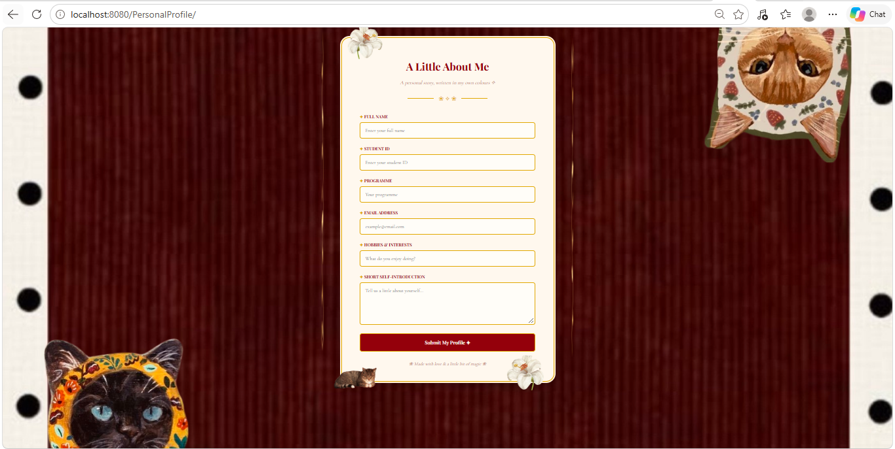
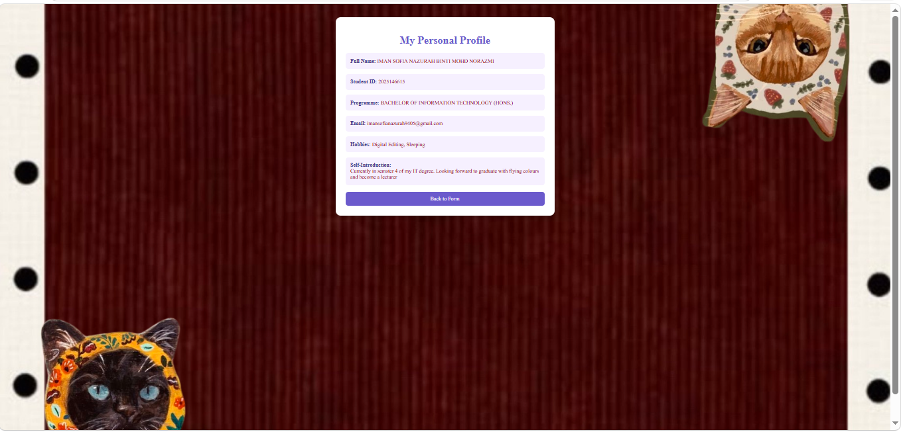
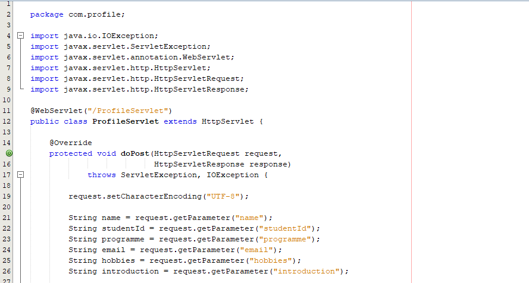
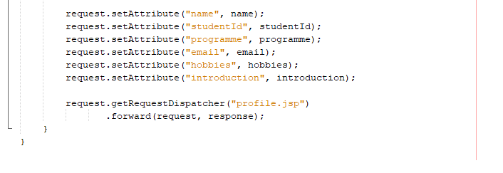

# CSC584 Individual Assignment 1 - IMAN SOFIA NAZURAH BINTI MOHD NORAZMI (2025146615) CDCS2404A
## Personal Profile Web Application

### 1. Project Description

The Personal Profile Web Application is developed using HTML, CSS, Java Servlet, and JavaServer Pages (JSP). The application allows users to enter their personal information through an HTML form, submit the information using HTTP POST, and view their submitted profile on a JSP page.

The application features a vintage-inspired interface with decorative floral elements, cat illustrations, and a customized background to create an attractive and user-friendly design.

### 2. Project Objectives

- To develop a personal profile form using HTML.
- To process user input using Java Servlet.
- To display submitted personal information using JSP.
- To implement communication between HTML, Servlet, and JSP using HTTP POST.
- To create a readable, attractive, and user-friendly interface.

### 3. Application Features

- Personal profile form with clearly labelled input fields.
- Input fields for Name, Student ID, Programme, Email, Hobbies, and Short Self-Introduction.
- Form submission using HTTP POST.
- User input processing through ProfileServlet.
- Profile information display using profile.jsp.
- Customized CSS styling with a vintage-inspired design.
- Decorative background, floral images, and cat illustrations.
- Navigation back to the profile form.

### 4. Technologies Used

| Technology | Purpose |
|---|---|
| HTML | To create the personal profile form |
| CSS | To style the web application |
| Java Servlet | To process submitted form information |
| JSP | To display the submitted profile |
| NetBeans IDE | To develop the web application |
| GlassFish Server | To run and deploy the web application |
| GitHub | To store and share the project source code |

### 5. Application Screenshots

#### 5.1 Personal Profile Form

The personal profile form allows users to enter their information before submitting it.

#### 5.2 Submitted Personal Profile

The profile page displays the information submitted by the user.

### 6. Java Servlet Implementation

#### 6.1 ProfileServlet - Part 1

This screenshot shows the servlet configuration and retrieval of submitted form values.

#### 6.2 ProfileServlet - Part 2

This screenshot shows the request attributes being set and the request being forwarded to profile.jsp.

### 7. Project Structure

The project contains the following files and folders:

- `nbproject/` - NetBeans project configuration files.
- `src/` - Java source code, including ProfileServlet.
- `web/` - HTML, JSP, and image resources.
- `Screenshots/` - Screenshots of the application outputs and servlet implementation.
- `build.xml` - Ant build configuration file.
- `README.md` - Project documentation.

### 8. Instructions to Run the Application

#### Required Software

- NetBeans IDE
- GlassFish Server

#### Steps to Run

1. Install NetBeans IDE and configure GlassFish Server.
2. Download or clone the project repository from GitHub.
3. Open NetBeans IDE.
4. Select **File → Open Project**.
5. Locate and select the PersonalProfile project folder.
6. Ensure that GlassFish Server is configured as the project's server.
7. Right-click the project in NetBeans and select **Run**.
8. Wait for the application to deploy and open in the web browser.
9. Enter the required personal information into the HTML form.
10. Click **Submit My Profile** to submit the information.
11. Verify that the submitted information is displayed correctly on the profile page.

### 9. Conclusion

The Personal Profile Web Application demonstrates the integration of HTML, CSS, Java Servlet, and JSP to collect, process, and display personal information. The application successfully implements the required data flow from the HTML form to the Servlet using HTTP POST and subsequently displays the submitted information on the JSP page. The customized interface provides a simple, readable, and visually appealing user experience.
